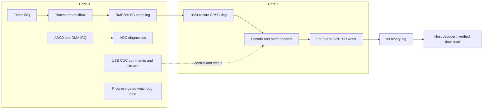

# PicoLogger

PicoLogger is C11 firmware for the Raspberry Pi Pico/RP2040. It samples a
BME280, captures a separate 10 kHz ADC diagnostic stream, writes BME280 records
to microSD and provides USB CDC commands. No attached board is confirmed and no
hardware measurements have been performed.

## Wiring

Power down before wiring. Use 3.3 V-compatible devices, common ground, and
never drive an RP2040 pin above 3.3 V. Check module pull-ups and supply limits.

| Connection | Pico pin | Notes |
| --- | --- | --- |
| BME280 SDA / SCL | GP4 / GP5 | I²C0, 3.3 V supply and GND; address 0x76 or 0x77 |
| microSD SCK / MOSI / MISO / CS | GP10 / GP11 / GP12 / GP13 | SPI1, 3.3 V-compatible module and FAT32 card |
| Timing output | GP15 | Foreground BME280 I²C read/compensation pulse |
| ADC0 input | GP26 | Keep within the ADC supply range; diagnostics only |
| USB CDC / power | USB | Data-capable cable; common ground for external instruments |
| Heartbeat | Onboard LED | Pico GPIO; Pico W uses CYW43 LED |

See [BME280 wiring](docs/BME280.md), [SD wiring](docs/SD_LOGGING.md) and
[safe ADC input](docs/ADC_DMA.md) for details.

## Build and flash

Install prerequisites and pinned tools locally, then run all checks:

```sh
scripts/setup.sh
scripts/check.sh
```

The check builds `build/pico/picologger.uf2` and
`build/pico_w/picologger.uf2`, runs sanitized host tests, clang-tidy and Python
tests. To flash **manually**, hold BOOTSEL while connecting the correct board,
copy its matching UF2 to the `RPI-RP2` volume, and let it reboot. The local
picotool is built without USB support; drag-and-drop is the default. See
[flashing and serial](docs/FLASHING.md). No agent has flashed a board.

## USB command reference

Commands are lowercase ASCII lines over USB CDC; replies start with `@`.
Stop and wait for acknowledgment before changing rate, saving settings or
dumping the active log. `start`, `stop`, some `rate` and config writes are
asynchronous: wait for their final `OK` or `ERR` after `PENDING`.

| Command | Purpose |
| --- | --- |
| `help`, `status` | List commands; report sampling, storage, power and fault counters |
| `stop`, `start` | Stop BME sampling and flush/close the log; open a new log and resume |
| `rate <1-50>` | Set runtime BME sampling rate while stopped |
| `stream on`, `stream off` | Enable/disable best-effort BME CSV over CDC |
| `ls`, `dump <filename>` | List root entries; transfer a completed file with CRC32 |
| `config get`, `config set <key> <value>`, `config reset` | Inspect/change saved settings for next boot |
| `reboot` | Flush/stop and request a watchdog reboot |
| `crash` | Hidden test-only deliberate HardFault and reset |

Settings keys are `rate`, `channels` (bit 0 BME, bit 1 ADC), `rotate_bytes`,
and `start_on_boot` (0/1). Flash writes intentionally pause ADC. See the full
[USB protocol](docs/USB_COMMANDS.md), [settings](docs/SETTINGS.md) and
[watchdog](docs/WATCHDOG.md) documentation. The host CLI supports status,
config, live plotting and verified downloads; see [host tools](docs/HOST_TOOLS.md).

## Log format

New files use version 3: a 512-byte little-endian header with a CRC-16 and
boot/fault metadata, followed by 32-byte records containing a 32-bit sequence,
64-bit microsecond timestamp, four signed channel slots, flags and a
CRC-16/CCITT-FALSE. BME channels are temperature (centi-°C), pressure (Pa),
and humidity (%RH × 1024). ADC blocks are not stored. The decoder supports
v1–v3 and checks record CRCs and sequence gaps:

```sh
.venv/bin/python tools/decode_log.py LOG_0001.BIN output.csv
```

See [format details](docs/LOG_FORMAT.md), [SD buffering](docs/SD_LOGGING.md)
and [power-loss recovery limits](docs/POWER_LOSS.md). Neither a sync nor the
recovery procedure guarantees all samples survive card or power failure.

## Architecture



Core 0 publishes records; core 1 drains the ring and owns FatFs. The hardware
inter-core FIFO is reserved for SDK control/flash lockout. At 1–10 Hz the Pico
uses guarded 48 MHz/WFI operation; Pico W falls back to normal clocks. See
[dual-core ordering](docs/DUAL_CORE.md) and [power](docs/POWER.md).

## Implementation and verification status

- **Implemented and locally verified:** both firmware builds, host tests,
  simulated storage/recovery, settings, fault reporting and USB host tooling.
- **Partial:** ADC blocks are diagnostics-only; BME humidity reference data is
  synthetic; recovery and flash protection have documented power-loss limits.
- **Unverified on hardware:** the HIL suite, USB/ADC/SD behavior, real-time
  performance, flash interruption, watchdog timing and current draw.

The 2026-11-08 local pass confirmed GitHub and PyPI access, reran project-local
setup, and passed `scripts/check.sh`: both firmware builds, 69 CTest cases with
sanitized host binaries, clang-tidy, six CLI tests and seven HIL-helper tests.
All six hardware cases were skipped. These are local build/simulation results,
not physical measurements.

See [verification evidence and limitations](docs/VERIFICATION.md) and the
prioritized [roadmap](ROADMAP.md) for the remaining work and estimates.

## License and third-party notices

Project-owned code is licensed under the [MIT License](LICENSE), copyright
2026 Mykyta Kizilov. Dependencies retain their own licenses and notices; see
[third-party notices](THIRD_PARTY_NOTICES.md) and `LICENSES/`. The pinned SD
dependency's SDIO provenance/terms require review before public publication or
binary distribution; do not assume the complete dependency bundle is MIT-only.

## Performance — unmeasured

Fill these values from the linked procedures; configured targets are not
hardware measurements.

| Measurement | Result | Procedure / context |
| --- | --- | --- |
| BME sampling jitter (min/max/mean) | **_____ µs — unmeasured** | [GP15 and interval checks](docs/SAMPLING.md) |
| Maximum reliable BME sample rate | **_____ Hz — unmeasured** | Firmware configuration permits 1–50 Hz; reliability is not established |
| ADC effective rate / continuity | **_____ Hz — unmeasured** | Nominal 10 kHz; [ADC checks](docs/ADC_DMA.md) |
| Worst SD write / sync latency | **_____ / _____ µs — unmeasured** | [SD checks](docs/SD_LOGGING.md) |
| Current, normal / low-rate | **_____ / _____ mA — unmeasured** | [USB power-meter table](docs/POWER.md) |

## Hardware-in-the-loop tests

Pytest HIL tests skip without an explicit port; they never auto-discover or
flash a device. They write logs and settings and reboot the board, so use an
expendable card and read [HIL safety and restoration](docs/HIL.md) first:

```sh
.venv/bin/python -m pytest -q tests/hil                  # skipped without a port
.venv/bin/python -m pytest -q -s tests/hil --hil-port /dev/cu.usbmodem...
```

### Manual checklist (not performed)

1. Build and flash the matching UF2, then connect the sensor and SD card as
   above; check USB banner, heartbeat and `status`.
2. Follow [HIL safety and restoration](docs/HIL.md), select the exact CDC port,
   and run the suite only on a prepared board and expendable card.
3. Inspect the HIL rate results, restored settings and SD logs; investigate any
   CRC, sequence, watchdog or drop failure. Complete the performance table only
   from independently observed measurements.
